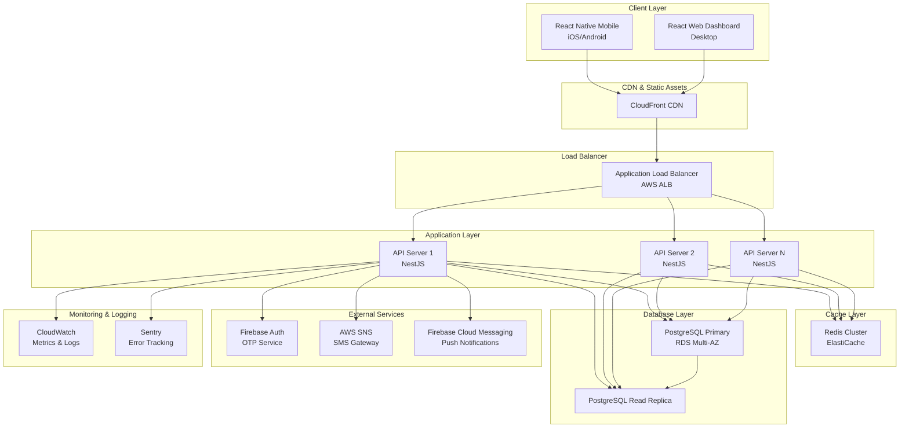
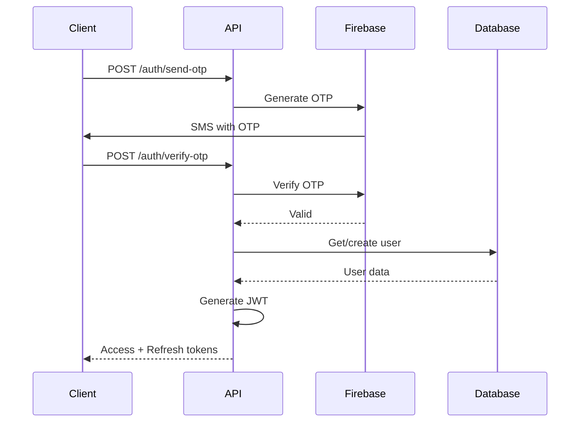
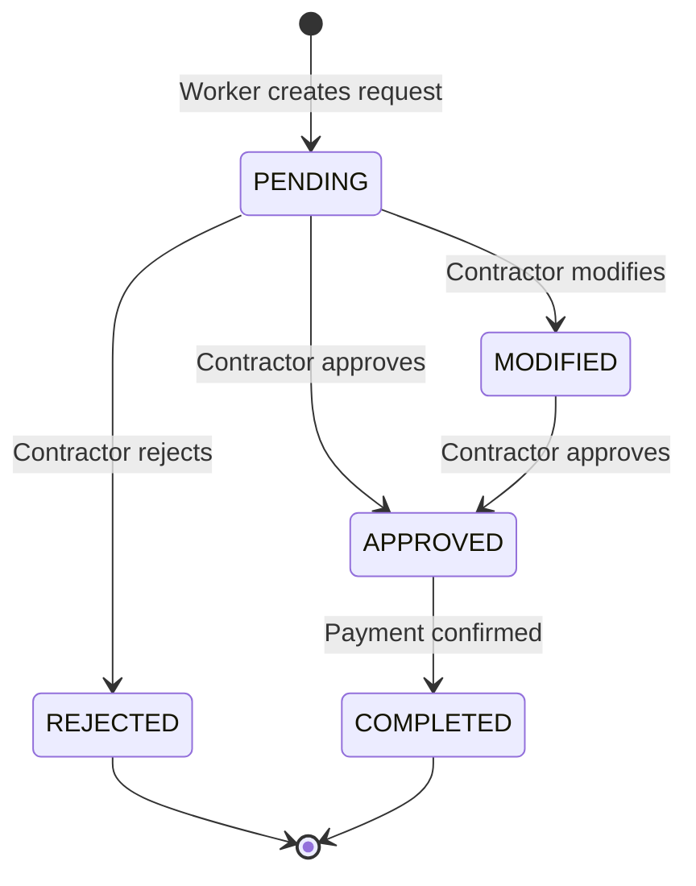
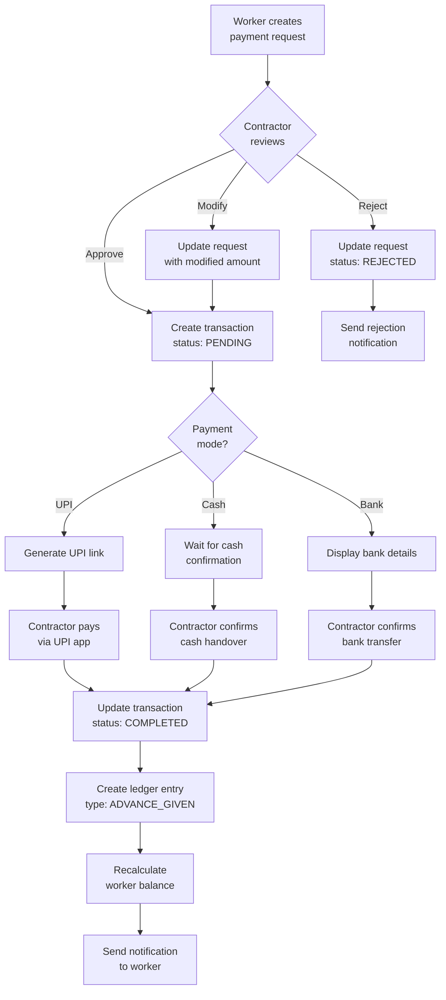
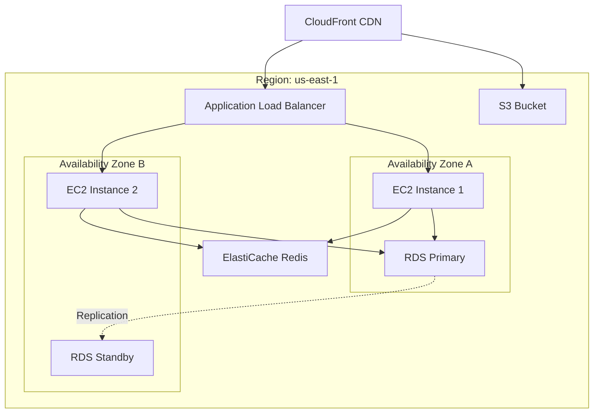
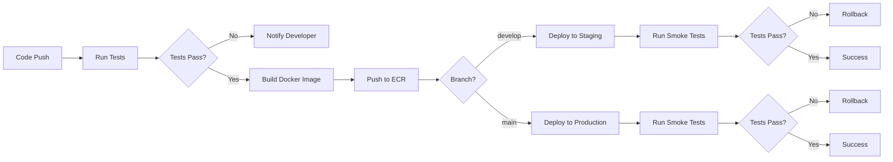

# PayTrack System Architecture

**Version:** 1.0.0  
**Last Updated:** January 2026

---

## Executive Summary

PayTrack is a **production-grade fintech application** designed to solve contractor payment tracking and advance management. The system is built with:

- **Scalability:** Microservices-ready architecture
- **Security:** Role-based access, encrypted data, audit trails
- **Reliability:** ACID-compliant database, immutable ledger
- **Performance:** Optimized queries, caching, CDN delivery
- **Maintainability:** Clean architecture, TypeScript, comprehensive tests

---

## High-Level Architecture



---

## Technology Stack

### Frontend

| Component | Technology | Justification |
|-----------|-----------|---------------|
| Mobile App | React Native | Cross-platform (iOS/Android), single codebase, native performance |
| Web Dashboard | React + TypeScript | Rich ecosystem, component reusability, type safety |
| UI Library | React Native Paper (mobile)<br/>Material-UI (web) | Consistent design system, accessibility |
| State Management | React Context + Hooks | Simple, built-in, sufficient for app complexity |
| API Client | Axios | Interceptors for auth, error handling, request/response transformation |
| Form Handling | Formik + Yup | Validation, error handling, form state management |
| Charts | Recharts | Responsive, customizable, React-native |

### Backend

| Component | Technology | Justification |
|-----------|-----------|---------------|
| Framework | NestJS | TypeScript, modular architecture, built-in DI, scalable |
| Runtime | Node.js 20 LTS | Performance, async I/O, large ecosystem |
| ORM | TypeORM | TypeScript support, migrations, query builder |
| Validation | class-validator | Decorator-based, integrates with NestJS |
| Authentication | Passport + JWT | Industry standard, flexible, secure |
| API Documentation | Swagger/OpenAPI | Auto-generated from decorators, interactive docs |

### Database

| Component | Technology | Justification |
|-----------|-----------|---------------|
| Primary Database | PostgreSQL 15 | ACID compliance, JSONB support, mature, reliable |
| Caching | Redis 7 | In-memory speed, pub/sub for real-time features |
| Search (future) | Elasticsearch | Full-text search, analytics |

### Infrastructure

| Component | Technology | Justification |
|-----------|-----------|---------------|
| Cloud Provider | AWS | Reliability, global reach, managed services |
| Compute | EC2 (t3.medium) | Cost-effective, scalable |
| Database | RDS PostgreSQL | Managed, automated backups, Multi-AZ |
| Cache | ElastiCache Redis | Managed, high availability |
| Load Balancer | Application Load Balancer | Layer 7, health checks, SSL termination |
| CDN | CloudFront | Global edge locations, HTTPS, caching |
| Storage | S3 | Object storage for receipts, backups |
| Monitoring | CloudWatch + Sentry | Metrics, logs, error tracking |
| CI/CD | GitHub Actions | Integrated with repo, free for public repos |

### External Services

| Service | Purpose | Provider |
|---------|---------|----------|
| OTP Authentication | Phone number verification | Firebase Auth |
| SMS Gateway | OTP delivery | AWS SNS |
| Push Notifications | Mobile alerts | Firebase Cloud Messaging |
| Email (future) | Receipts, reports | AWS SES |

---

## System Components

### 1. API Gateway Layer

**Responsibilities:**
- Request routing
- Authentication & authorization
- Rate limiting
- Request/response logging
- CORS handling
- API versioning

**Implementation:**
- NestJS middleware
- Passport guards
- Custom interceptors

**Key Files:**
- `src/main.ts` - Bootstrap
- `src/guards/jwt-auth.guard.ts` - JWT verification
- `src/guards/roles.guard.ts` - Role-based access
- `src/interceptors/logging.interceptor.ts` - Request logging
- `src/interceptors/transform.interceptor.ts` - Response transformation

---

### 2. Authentication Service

**Responsibilities:**
- OTP generation and verification
- JWT token issuance and refresh
- User session management
- Phone number validation

**Flow:**


**Security Measures:**
- OTP expiry: 5 minutes
- Rate limiting: 5 OTP requests per hour per phone
- JWT expiry: 15 minutes (access), 7 days (refresh)
- Refresh token rotation
- Phone number verification

---

### 3. Payment Request Service

**Responsibilities:**
- Request creation (worker)
- Request approval/rejection (contractor)
- Amount modification
- Status tracking
- Notification triggering

**State Machine:**


**Business Rules:**
- Only workers can create requests
- Only contractor of the worker can approve/reject
- Approved requests automatically create transactions
- Rejected requests cannot be re-opened (must create new)
- Modifications require reason

---

### 4. Transaction Service

**Responsibilities:**
- Transaction creation on approval
- Payment method handling
- UPI deep link generation
- Cash payment confirmation
- Transaction status updates

**Payment Modes:**

| Mode | Flow | Verification |
|------|------|--------------|
| UPI | Generate deep link → Open UPI app → Manual confirmation | Manual (future: webhook) |
| Bank Transfer | Display account details → Manual transfer → Manual confirmation | Manual |
| Cash | Contractor hands cash → Contractor confirms | Manual (trust-based) |

**UPI Deep Link Format:**
```
upi://pay?pa={upiId}&pn={name}&am={amount}&tr={transactionId}&cu=INR
```

---

### 5. Ledger Service (CRITICAL)

**Responsibilities:**
- Immutable ledger entry creation
- Balance calculation
- Salary accrual tracking
- Adjustment entry creation
- Financial reporting

**Ledger Entry Types:**

| Type | Direction | Description |
|------|-----------|-------------|
| SALARY_EARNED | Credit | Monthly salary accrual |
| SALARY_PAID | Debit | Salary payment to worker |
| ADVANCE_GIVEN | Debit | Advance payment to worker |
| EXPENSE_REIMBURSED | Credit | Expense reimbursement |
| ADJUSTMENT_CREDIT | Credit | Manual correction (increase balance) |
| ADJUSTMENT_DEBIT | Debit | Manual correction (decrease balance) |

**Balance Calculation:**
```typescript
Outstanding Balance = 
  Salary Earned 
  - Salary Paid 
  - Advances Given 
  + Expense Reimbursed
  + Adjustment Credits 
  - Adjustment Debits
```

**Immutability Enforcement:**
- Database triggers prevent UPDATE/DELETE
- Application layer prevents modifications
- All corrections via new adjustment entries
- Audit trail for all entries

---

### 6. Notification Service

**Responsibilities:**
- Push notification delivery
- SMS notification delivery
- In-app notification creation
- Notification preferences management

**Notification Types:**

| Event | Recipient | Channel |
|-------|-----------|---------|
| Payment request created | Contractor | Push + In-app |
| Request approved | Worker | Push + In-app + SMS |
| Request rejected | Worker | Push + In-app |
| Request modified | Worker | Push + In-app |
| Cash payment confirmed | Worker | Push + In-app |
| Low balance alert | Contractor | Push + In-app |

---

### 7. User Service

**Responsibilities:**
- User CRUD operations
- Contractor profile management
- Worker profile management
- Role assignment
- Profile validation

**User Hierarchy:**
```
User (phone, role)
  ├── ContractorProfile (business details)
  │     └── WorkerProfiles (multiple workers)
  └── WorkerProfile (personal details, salary)
```

---

### 8. Project Service

**Responsibilities:**
- Project CRUD operations
- Worker assignment to projects
- Project-wise reporting
- Project status tracking

---

## Data Flow

### Payment Request to Ledger Entry



---

## Security Architecture

### Authentication & Authorization

**Multi-Layer Security:**
1. **Network Layer:** HTTPS only, TLS 1.3
2. **API Layer:** JWT validation on every request
3. **Service Layer:** Role-based guards
4. **Data Layer:** Row-level security (future)

**Role-Based Access Control (RBAC):**

| Role | Permissions |
|------|-------------|
| CONTRACTOR | Create workers, approve/reject requests, view all workers, create adjustments |
| WORKER | Create payment requests, view own data, view own ledger |
| ADMIN | Full system access, user management, system configuration |

**Authorization Matrix:**

| Endpoint | CONTRACTOR | WORKER | ADMIN |
|----------|------------|--------|-------|
| POST /payment-requests | ❌ | ✅ | ✅ |
| PATCH /payment-requests/:id/approve | ✅ (own workers) | ❌ | ✅ |
| GET /workers | ✅ (own workers) | ❌ | ✅ |
| POST /workers | ✅ | ❌ | ✅ |
| GET /ledger/worker/:id | ✅ (own workers) | ✅ (self only) | ✅ |
| POST /ledger/adjustments | ✅ | ❌ | ✅ |

### Data Encryption

- **In Transit:** TLS 1.3 for all API communication
- **At Rest:** RDS encryption enabled
- **Sensitive Fields:** PAN, Aadhar, bank account numbers encrypted at application layer
- **Secrets Management:** AWS Secrets Manager for API keys, database credentials

### Audit Trail

**All critical actions logged:**
- User authentication
- Payment request creation/approval/rejection
- Transaction creation/completion
- Ledger entry creation
- User profile modifications

**Audit Log Schema:**
```sql
CREATE TABLE audit_log (
  id UUID PRIMARY KEY,
  user_id UUID,
  action VARCHAR(100),
  entity_type VARCHAR(50),
  entity_id UUID,
  old_values JSONB,
  new_values JSONB,
  ip_address INET,
  user_agent TEXT,
  created_at TIMESTAMPTZ
);
```

---

## Scalability Strategy

### Horizontal Scaling

**Application Servers:**
- Stateless API servers
- Auto Scaling Group (2-10 instances)
- Scale based on CPU (>70%) and request count

**Database:**
- Read replicas for reporting queries
- Connection pooling (max 100 connections per instance)
- Query optimization with indexes

**Caching:**
- Redis for session storage
- Cache user profiles (TTL: 15 minutes)
- Cache dashboard data (TTL: 5 minutes)
- Cache invalidation on data mutation

### Vertical Scaling

**Database:**
- Start: db.t3.medium (2 vCPU, 4 GB RAM)
- Scale to: db.r5.large (2 vCPU, 16 GB RAM)

**Application:**
- Start: t3.medium (2 vCPU, 4 GB RAM)
- Scale to: t3.large (2 vCPU, 8 GB RAM)

### Performance Optimization

**Database:**
- Composite indexes on common queries
- Materialized views for complex reports
- Partitioning for large tables (future)

**API:**
- Response compression (gzip)
- Pagination for list endpoints
- Field selection (GraphQL-style, future)

**Frontend:**
- Code splitting
- Lazy loading
- Image optimization
- CDN for static assets

---

## Deployment Architecture

### Environments

| Environment | Purpose | Infrastructure |
|-------------|---------|----------------|
| Development | Local development | Docker Compose |
| Staging | Pre-production testing | AWS (single instance) |
| Production | Live system | AWS (multi-AZ, auto-scaling) |

### Production Infrastructure



**High Availability:**
- Multi-AZ RDS (automatic failover)
- Multiple EC2 instances across AZs
- Redis cluster mode (future)
- S3 for durable storage

**Disaster Recovery:**
- Automated daily database backups (retained 30 days)
- Point-in-time recovery (5-minute granularity)
- Cross-region backup replication (future)
- Infrastructure as Code (Terraform) for quick rebuild

---

## Monitoring & Observability

### Metrics

**Application Metrics:**
- Request rate (requests/second)
- Response time (p50, p95, p99)
- Error rate (4xx, 5xx)
- Active users
- Transaction volume

**Infrastructure Metrics:**
- CPU utilization
- Memory utilization
- Disk I/O
- Network throughput
- Database connections

**Business Metrics:**
- Payment requests created
- Approval rate
- Average approval time
- Transaction success rate
- User growth

### Logging

**Log Levels:**
- ERROR: Application errors, exceptions
- WARN: Potential issues, deprecated features
- INFO: Important business events
- DEBUG: Detailed debugging information

**Centralized Logging:**
- CloudWatch Logs for all services
- Structured logging (JSON format)
- Log retention: 30 days

### Alerting

**Critical Alerts (PagerDuty):**
- API error rate > 5%
- Database connection failures
- Payment processing failures
- Authentication service down

**Warning Alerts (Slack):**
- API response time > 1s (p95)
- Database CPU > 80%
- Disk space < 20%
- High memory usage

---

## CI/CD Pipeline

### GitHub Actions Workflow



### Deployment Strategy

**Blue-Green Deployment:**
1. Deploy new version to "green" environment
2. Run health checks
3. Switch traffic from "blue" to "green"
4. Keep "blue" for quick rollback
5. Decommission "blue" after 24 hours

**Database Migrations:**
- Backward-compatible migrations
- Run before application deployment
- Automatic rollback on failure

---

## API Versioning Strategy

**URL-based versioning:**
- Current: `/v1/payment-requests`
- Future: `/v2/payment-requests`

**Deprecation Policy:**
- 6-month notice for breaking changes
- Support previous version for 12 months
- Clear migration guides

---

## Future Enhancements

### Phase 2 (3-6 months)
- Automated salary accrual (cron job)
- Payment gateway integration (Razorpay)
- WhatsApp notifications
- Multi-language support (Hindi, Tamil, Telugu)

### Phase 3 (6-12 months)
- Biometric authentication
- Offline mode with sync
- Worker attendance tracking
- Geofencing for cash payments
- GST invoice generation

### Phase 4 (12+ months)
- AI-powered fraud detection
- Predictive analytics
- Tax reporting automation
- Multi-contractor support for workers
- Marketplace for contractor services

---

## Technology Decisions & Trade-offs

| Decision | Rationale | Trade-off |
|----------|-----------|-----------|
| NestJS over Express | Structure, TypeScript, DI | Steeper learning curve |
| PostgreSQL over MongoDB | ACID, relational data, complex queries | Less flexible schema |
| React Native over Native | Single codebase, faster development | Slightly lower performance |
| Firebase Auth over Custom | Quick setup, reliable, scalable | Vendor lock-in |
| Manual payment confirmation over Webhooks | Faster MVP, no gateway fees | Manual process, trust-based |
| JWT over Session | Stateless, scalable | Token size, revocation complexity |

---

## Compliance & Regulatory Considerations

### Data Residency
- All data stored in India region (future)
- Compliance with RBI guidelines

### Data Privacy
- GDPR-ready (data export, deletion)
- User consent for data collection
- Privacy policy and terms of service

### Financial Regulations
- Not a payment processor (orchestration only)
- No PCI DSS compliance required
- Future: GST compliance for invoicing

---

## Conclusion

PayTrack is architected as a **production-grade fintech system** with:
- ✅ Scalable, modular architecture
- ✅ Security-first design
- ✅ Immutable financial ledger
- ✅ Comprehensive audit trail
- ✅ High availability and disaster recovery
- ✅ Monitoring and observability
- ✅ CI/CD automation

The system is ready for **real-world deployment** and can scale to support thousands of contractors and tens of thousands of workers.
