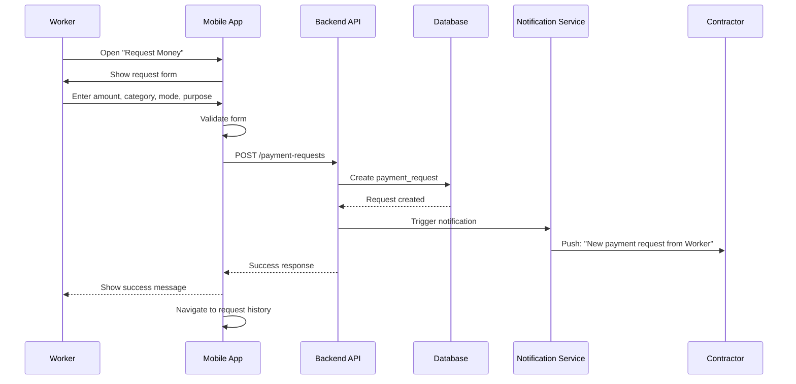
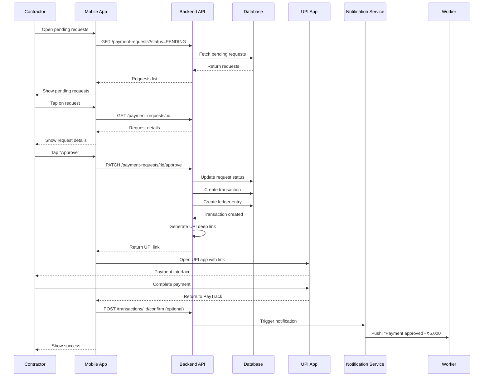
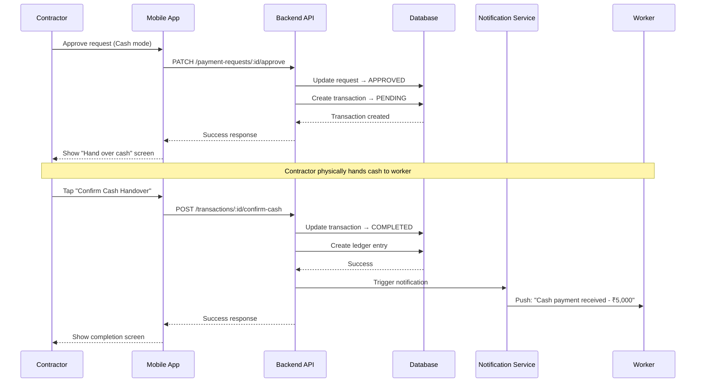
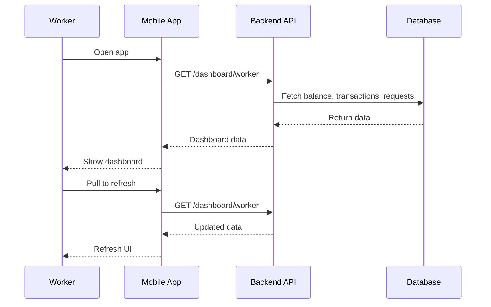
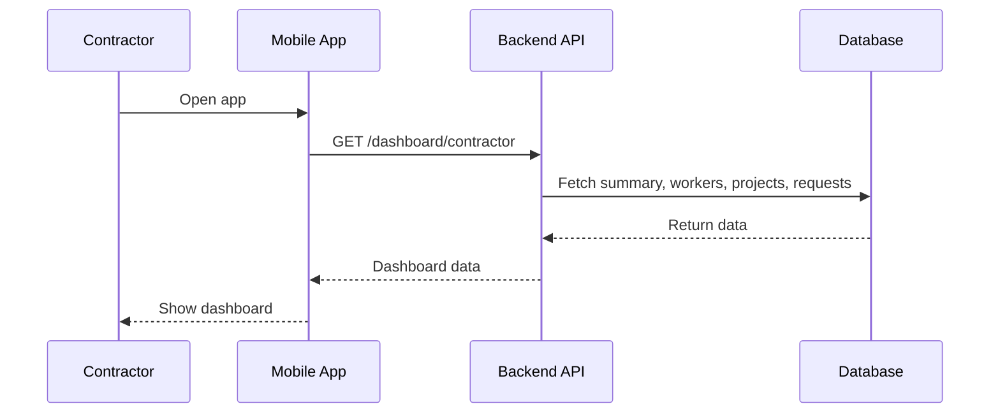
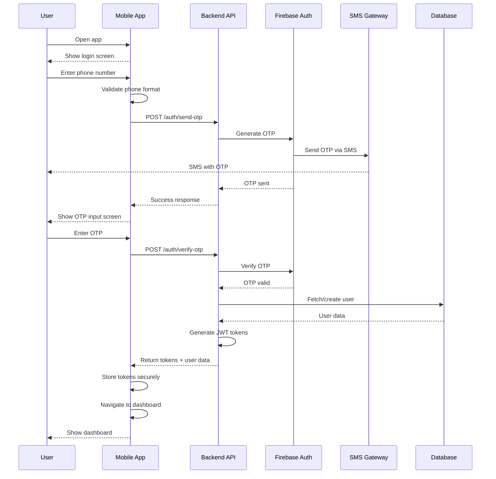
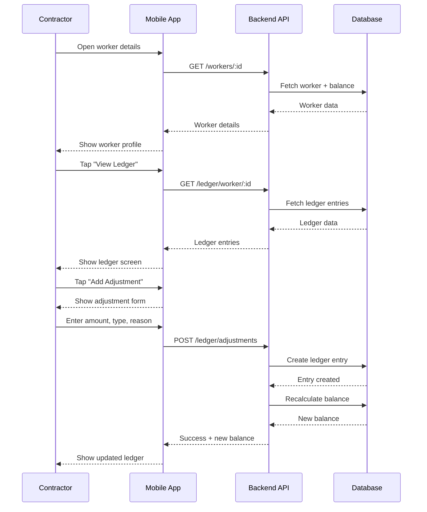
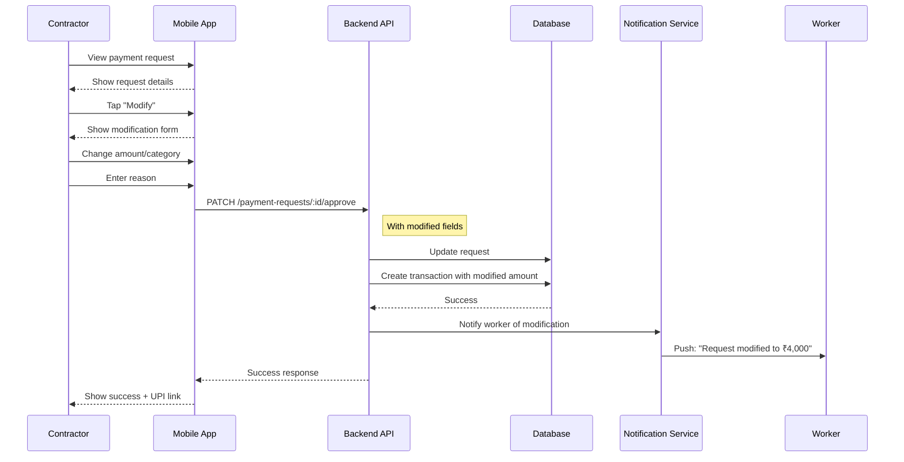
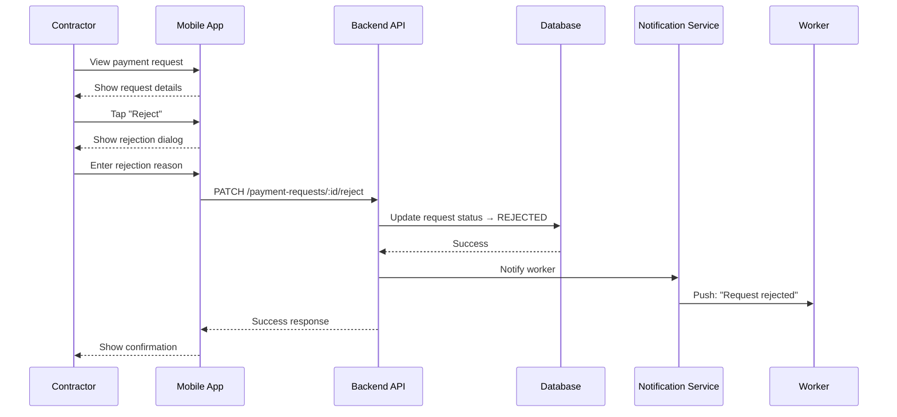
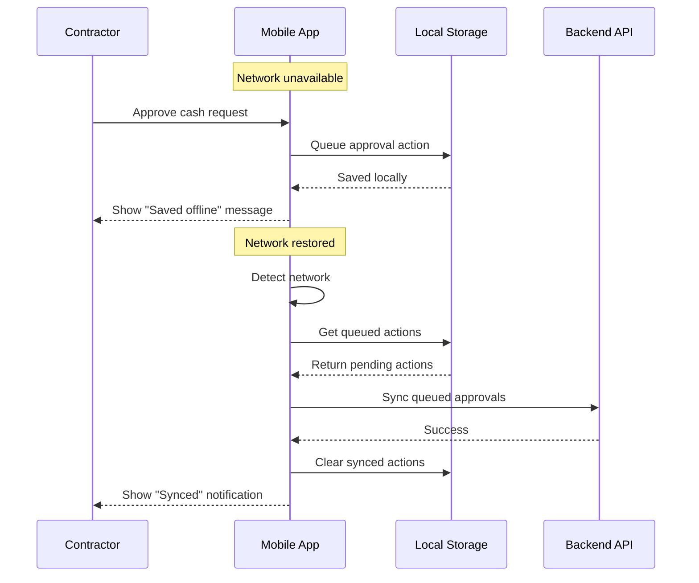

# PayTrack User Flows

Complete user journey documentation for all critical workflows in the PayTrack system.

---

## 1. Worker Request Money Flow

### Flow Diagram



### Step-by-Step

1. **Worker opens app** → Navigates to "Request Money" screen
2. **Form display:**
   - Amount input (numeric keypad)
   - Category selector (Advance / Salary / Expense)
   - Payment mode selector (Cash / UPI / Bank Transfer)
   - Purpose dropdown (Medical / Personal / Family / Other)
   - Notes field (optional)
3. **Worker fills form:**
   - Enters amount: ₹5,000
   - Selects category: "Advance"
   - Selects mode: "UPI"
   - Adds note: "Medical emergency"
4. **Validation:**
   - Amount > 0
   - All required fields filled
5. **Submit request:**
   - API call: `POST /payment-requests`
   - Loading indicator shown
6. **Success:**
   - Request created with status "PENDING"
   - Success toast: "Request submitted successfully"
   - Navigate to "My Requests" screen
7. **Contractor notification:**
   - Push notification sent
   - Badge count updated
   - In-app notification created

### UI Screens

**Screen 1: Request Money Form**
- Header: "Request Money"
- Amount input (large, prominent)
- Category chips (Advance, Salary, Expense)
- Payment mode chips (Cash, UPI, Bank)
- Purpose dropdown
- Notes textarea
- Submit button (disabled until valid)

**Screen 2: Success Confirmation**
- Success icon
- Message: "Request submitted"
- Request ID
- Amount
- Status: "Pending approval"
- Button: "View Request"

---

## 2. Contractor Approval Flow (UPI Payment)

### Flow Diagram



### Step-by-Step

1. **Contractor opens app** → Sees badge with pending count
2. **Navigate to "Pending Requests"**
3. **View request list:**
   - Worker name
   - Amount
   - Category
   - Time ago
   - Tap to view details
4. **Request details screen:**
   - Worker profile photo
   - Worker name
   - Amount (large)
   - Category badge
   - Payment mode
   - Purpose
   - Notes
   - Current worker balance
   - Action buttons: Approve / Reject / Modify
5. **Tap "Approve":**
   - Confirmation dialog: "Approve ₹5,000 advance for Ramesh?"
   - Confirm
6. **API processes approval:**
   - Update request status → APPROVED
   - Create transaction → PENDING
   - Create ledger entry → ADVANCE_GIVEN
   - Generate UPI link
7. **UPI deep link:**
   - Format: `upi://pay?pa=ramesh@paytm&pn=Ramesh&am=5000&tr=TXN123&cu=INR`
   - Opens Google Pay / PhonePe / BHIM
8. **Contractor completes payment in UPI app**
9. **Return to PayTrack:**
   - Transaction marked as COMPLETED (manual or webhook)
   - Success screen shown
10. **Worker notification:**
    - Push: "Your request for ₹5,000 has been approved"
    - In-app notification

### UI Screens

**Screen 1: Pending Requests List**
- Header: "Pending Requests" (with count badge)
- List items:
  - Worker avatar + name
  - Amount (bold)
  - Category badge
  - Time ago
  - Tap to expand

**Screen 2: Request Details**
- Worker info card
- Amount (large, centered)
- Category, mode, purpose
- Notes
- Worker balance summary
- Action buttons (full width)

**Screen 3: Approval Confirmation**
- Dialog overlay
- "Approve this request?"
- Amount + worker name
- Cancel / Confirm buttons

**Screen 4: UPI Redirect**
- Loading: "Opening payment app..."
- UPI app opens automatically

**Screen 5: Success**
- Success icon
- "Payment approved"
- Transaction ID
- Amount
- Button: "Back to Dashboard"

---

## 3. Contractor Approval Flow (Cash Payment)

### Flow Diagram



### Step-by-Step

1. **Contractor approves cash request** (similar to UPI flow)
2. **API creates pending transaction**
3. **App shows "Cash Handover" screen:**
   - Message: "Please hand over ₹5,000 in cash to Ramesh"
   - Worker name + photo
   - Amount (large)
   - Checkbox: "I have handed over the cash"
   - Button: "Confirm Handover" (disabled until checked)
4. **Contractor hands over physical cash**
5. **Contractor checks box and taps "Confirm"**
6. **API call:** `POST /transactions/:id/confirm-cash`
7. **Backend:**
   - Update transaction → COMPLETED
   - Set `cash_confirmed_at` timestamp
   - Create ledger entry
8. **Success screen:**
   - "Cash payment recorded"
   - Transaction ID
   - Receipt (optional print/share)
9. **Worker notification:**
   - Push: "Cash payment of ₹5,000 recorded"

### UI Screens

**Screen 1: Cash Handover**
- Icon: Hand with cash
- Message: "Hand over cash to worker"
- Worker card (photo + name)
- Amount (large, bold)
- Checkbox: "Cash handed over"
- Confirm button

**Screen 2: Success**
- Success icon
- "Cash payment recorded"
- Transaction details
- Share receipt button

---

## 4. Worker Dashboard View

### Flow Diagram



### Dashboard Components

**1. Balance Card (Top)**
- Outstanding balance (large, color-coded)
  - Green if positive (contractor owes worker)
  - Red if negative (worker owes contractor)
- Breakdown:
  - Salary earned this month
  - Salary paid
  - Advances taken

**2. Quick Actions**
- Request Money (primary button)
- View History
- View Ledger

**3. Monthly Summary**
- Total received this month
- Transaction count
- Advance vs Salary chart (pie/donut)

**4. Recent Transactions (Last 5)**
- Date
- Amount
- Category
- Status

**5. Pending Requests**
- Count badge
- List of pending requests

### UI Layout

```
┌─────────────────────────────┐
│  Outstanding Balance        │
│  ₹ -5,000                   │
│  ────────────────────────   │
│  Earned: ₹25,000            │
│  Paid: ₹10,000              │
│  Advance: ₹20,000           │
└─────────────────────────────┘

┌─────────────────────────────┐
│  [Request Money]            │
└─────────────────────────────┘

┌─────────────────────────────┐
│  This Month                 │
│  Total: ₹30,000             │
│  Transactions: 8            │
│  [Chart: Advance vs Salary] │
└─────────────────────────────┘

┌─────────────────────────────┐
│  Recent Transactions        │
│  ─────────────────────────  │
│  Jan 24  Advance   ₹5,000   │
│  Jan 20  Salary    ₹10,000  │
│  Jan 15  Advance   ₹3,000   │
│  [View All]                 │
└─────────────────────────────┘
```

---

## 5. Contractor Dashboard View

### Flow Diagram



### Dashboard Components

**1. Summary Cards (Top Row)**
- Total spent this month
- Active workers count
- Pending requests count
- Total transactions

**2. Pending Requests (Priority)**
- List of pending requests
- Quick approve/reject actions

**3. Spending Breakdown**
- Advance vs Salary (pie chart)
- Cash vs Digital (bar chart)
- Month-over-month trend (line chart)

**4. Worker List**
- Name
- Current balance
- Last transaction
- Quick view button

**5. Project Summary**
- Project name
- Workers assigned
- Total spent
- Progress

### UI Layout

```
┌──────────────┬──────────────┐
│ Total Spent  │ Active       │
│ ₹1,50,000    │ Workers: 10  │
├──────────────┼──────────────┤
│ Pending      │ Transactions │
│ Requests: 3  │ This Month:45│
└──────────────┴──────────────┘

┌─────────────────────────────┐
│  Pending Requests (3)       │
│  ─────────────────────────  │
│  Ramesh  ₹5,000  [Approve]  │
│  Suresh  ₹3,000  [Approve]  │
│  [View All]                 │
└─────────────────────────────┘

┌─────────────────────────────┐
│  Spending Breakdown         │
│  [Advance vs Salary Chart]  │
│  [Cash vs Digital Chart]    │
└─────────────────────────────┘

┌─────────────────────────────┐
│  Workers                    │
│  ─────────────────────────  │
│  Ramesh   Balance: -₹5,000  │
│  Suresh   Balance: ₹2,000   │
│  [View All Workers]         │
└─────────────────────────────┘
```

---

## 6. OTP Authentication Flow

### Flow Diagram



### Step-by-Step

1. **User opens app** → Login screen shown
2. **Enter phone number:**
   - Input: +91 9876543210
   - Validation: Format check
   - Button: "Send OTP"
3. **Tap "Send OTP":**
   - API call: `POST /auth/send-otp`
   - Loading indicator
4. **OTP sent:**
   - SMS delivered to phone
   - Auto-navigate to OTP screen
   - Timer: 5 minutes countdown
5. **OTP input screen:**
   - 6-digit OTP input
   - Auto-submit when 6 digits entered
   - Resend OTP button (disabled for 30s)
6. **Enter OTP:**
   - Auto-detect from SMS (Android)
   - Manual entry
7. **Verify OTP:**
   - API call: `POST /auth/verify-otp`
   - Loading indicator
8. **Success:**
   - JWT tokens stored in secure storage
   - User role detected (Contractor / Worker)
   - Navigate to role-specific dashboard
9. **Error handling:**
   - Invalid OTP → Show error, allow retry
   - Expired OTP → Show error, offer resend
   - Network error → Show retry button

### UI Screens

**Screen 1: Phone Number Input**
- Logo
- Title: "Welcome to PayTrack"
- Phone input (with country code selector)
- Send OTP button
- Terms & Privacy links

**Screen 2: OTP Input**
- Title: "Enter OTP"
- Subtitle: "Sent to +91 98765 43210"
- 6-digit input boxes
- Timer: "Expires in 4:32"
- Resend OTP link
- Auto-submit on completion

**Screen 3: Loading**
- Spinner
- "Verifying..."

**Screen 4: Success**
- Brief success animation
- Auto-navigate to dashboard

---

## 7. Ledger Reconciliation Flow

### Flow Diagram



### Step-by-Step

1. **Contractor opens worker details**
2. **Tap "View Ledger"**
3. **Ledger screen shows:**
   - Current balance (top)
   - Filter options (date range, entry type)
   - List of all ledger entries (chronological)
4. **Each entry shows:**
   - Date
   - Entry type (Salary Earned, Advance Given, etc.)
   - Amount
   - Description
   - Transaction link (if applicable)
5. **Tap "Add Adjustment":**
   - Form appears
   - Select type: Credit / Debit
   - Enter amount
   - Enter reason (required)
6. **Submit adjustment:**
   - API call: `POST /ledger/adjustments`
   - New entry created
   - Balance recalculated
   - Ledger refreshed
7. **Immutability enforcement:**
   - No edit/delete buttons on entries
   - All corrections via new adjustments

### UI Screens

**Screen 1: Ledger View**
```
┌─────────────────────────────┐
│  Ramesh Kumar               │
│  Outstanding: ₹-5,000       │
│  ─────────────────────────  │
│  [Filter] [Add Adjustment]  │
└─────────────────────────────┘

┌─────────────────────────────┐
│  Jan 24, 2026               │
│  Advance Given              │
│  -₹5,000                    │
│  Payment request #1234      │
├─────────────────────────────┤
│  Jan 20, 2026               │
│  Salary Paid                │
│  -₹10,000                   │
│  Payment request #1230      │
├─────────────────────────────┤
│  Jan 1, 2026                │
│  Salary Earned              │
│  +₹25,000                   │
│  January 2026 accrual       │
└─────────────────────────────┘
```

**Screen 2: Add Adjustment**
- Dialog/modal
- Type selector: Credit / Debit
- Amount input
- Reason textarea (required)
- Cancel / Submit buttons

---

## 8. Payment Request Modification Flow

### Flow Diagram



### Step-by-Step

1. **Contractor views request for ₹5,000**
2. **Tap "Modify" button**
3. **Modification form:**
   - Original amount: ₹5,000 (shown, grayed out)
   - New amount input: ₹4,000
   - Category selector (optional change)
   - Reason textarea (required)
4. **Enter modification:**
   - New amount: ₹4,000
   - Reason: "Reduced to available advance limit"
5. **Submit:**
   - API call with `modifiedAmount` and `modificationReason`
   - Transaction created with ₹4,000
6. **Worker notification:**
   - "Your request has been modified"
   - Original: ₹5,000
   - Approved: ₹4,000
   - Reason: "Reduced to available advance limit"
7. **Proceed with payment:**
   - UPI link generated for ₹4,000
   - Continue with normal approval flow

---

## 9. Rejection Flow

### Flow Diagram



### Step-by-Step

1. **Contractor views request**
2. **Tap "Reject" button**
3. **Rejection dialog:**
   - Title: "Reject this request?"
   - Reason textarea (required)
   - Predefined reasons (optional):
     - "Insufficient funds"
     - "Already paid in cash"
     - "Incorrect amount"
     - "Other" (custom reason)
4. **Enter reason and confirm**
5. **API updates request:**
   - Status → REJECTED
   - Set `rejection_reason`
   - Set `reviewed_at` timestamp
6. **Worker notification:**
   - "Your request for ₹5,000 has been rejected"
   - Reason: "Insufficient funds available"
7. **Worker can:**
   - View rejection reason
   - Create new request

---

## 10. Offline Mode (Cash Payments)

### Flow Diagram



### Step-by-Step

1. **Contractor is offline** (no network)
2. **Approves cash payment request**
3. **App detects offline state:**
   - Save action to local queue
   - Show toast: "Saved offline. Will sync when online."
   - Mark transaction as "Pending Sync"
4. **Network restored:**
   - Auto-detect connectivity
   - Background sync starts
5. **Sync process:**
   - Send queued actions to API
   - Update local state with server response
   - Clear synced items from queue
6. **Success notification:**
   - "All offline actions synced"
7. **Conflict resolution:**
   - If request already processed → Show error, remove from queue
   - If worker deleted → Show error, remove from queue

---

## Summary of Critical Flows

| Flow | Actors | Key Steps | Critical Points |
|------|--------|-----------|-----------------|
| Request Money | Worker | Create request → Submit → Wait for approval | Validation, notification |
| Approve (UPI) | Contractor | Review → Approve → UPI redirect → Complete | Deep linking, ledger entry |
| Approve (Cash) | Contractor | Review → Approve → Hand cash → Confirm | Manual confirmation, trust |
| Reject | Contractor | Review → Reject with reason → Notify | Clear communication |
| Modify | Contractor | Review → Modify amount → Approve | Transparency to worker |
| View Ledger | Both | Navigate → View entries → Filter | Immutability, clarity |
| Add Adjustment | Contractor | Open ledger → Add entry → Recalculate | Audit trail |
| OTP Login | Both | Enter phone → Receive OTP → Verify → Dashboard | Security, UX |
| Offline Sync | Contractor | Offline action → Queue → Auto-sync | Data integrity |

---

## Design Principles

1. **Mobile-First:** All flows optimized for thumb-friendly interactions
2. **Minimal Steps:** Reduce friction in critical paths (request, approve)
3. **Clear Feedback:** Every action has immediate visual confirmation
4. **Error Recovery:** Graceful handling of failures with retry options
5. **Transparency:** Workers always know request status and modifications
6. **Audit Trail:** Every financial action is logged and immutable
7. **Offline Tolerance:** Cash payments work without connectivity
8. **Security:** OTP-based auth, role-based access, encrypted data
